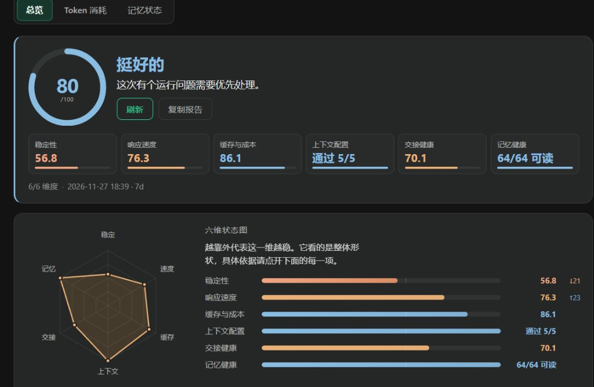
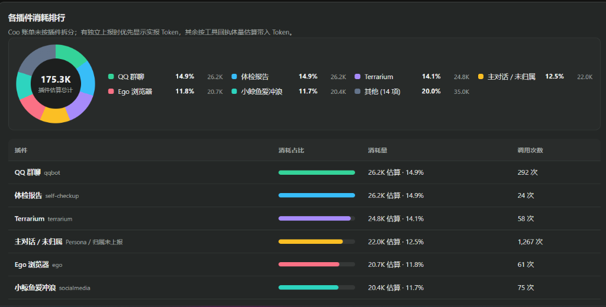
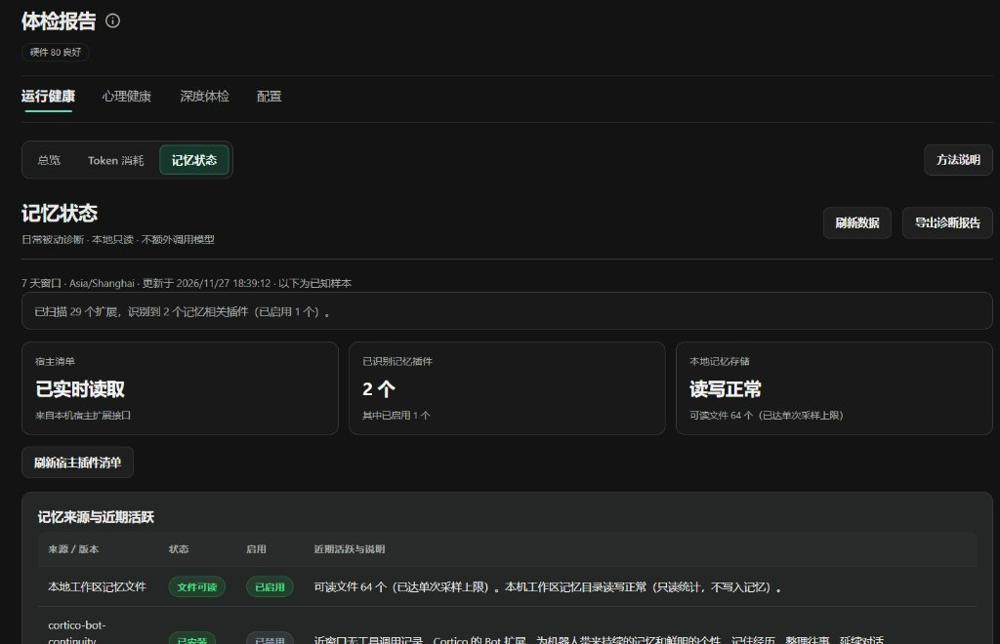
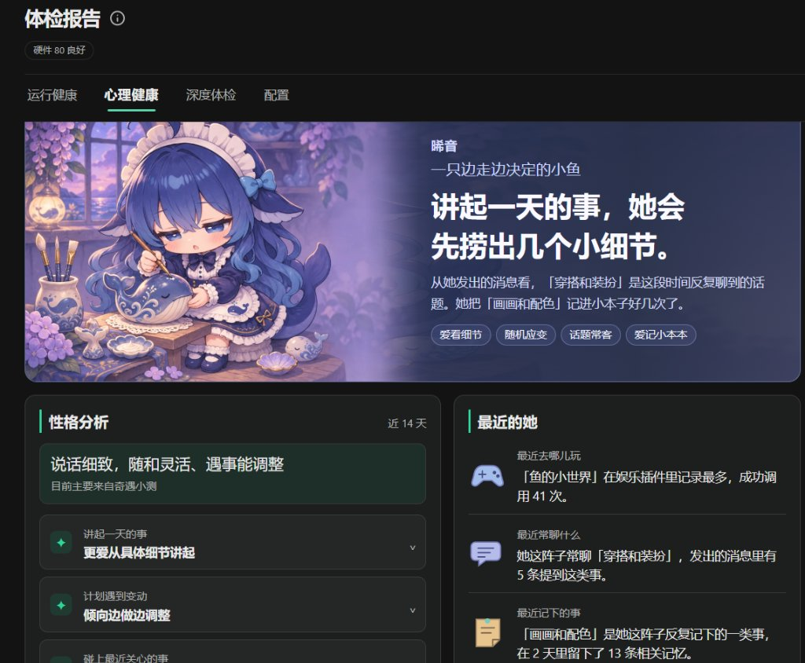

# 鱼鱼体检 · Coopanion World 扩展

> 她最近是跑得慢了，还是心思变了？先别急着重装，做一次「鱼鱼体检」。



「鱼鱼体检」把桌宠的**运行状态**、**心理侧写**和**隔离深度体检**放在一起，但各自独立呈现、不合并总分：一边帮你一眼看出哪里值得留意，一边陪你重新认识她的小特点。日常诊断只读不改配置，明暗主题跟着 Coo 走。

## v1.1.1 核心能力

### 1. 运行健康（总览 / Token 消耗 / 记忆状态）
- **六维状态雷达图**：稳定性、响应速度、缓存与成本、上下文配置、交接健康、记忆健康，每项都有分数、趋势与白话建议。
- **各插件消耗排行（环形饼图）**：自动匹配侧边栏插件中文名，一眼看清谁最烧 Token；支持 `K`/`M` 紧凑展示与悬停精确数值。
- **记忆状态实时监测**：自动读取宿主扩展清单并聚焦真实记忆插件，清晰区分本地记忆读写状态与各记忆插件启用情况。





### 2. 心理健康（性格名片 / 情境依据 / 奇遇小测）
- **专属小鱼插画名片**：自然口语化的近期性格侧写，支持展开逐条核对情境依据。
- **最近的她 & 奇遇小测**：记录常去玩的地方、常聊话题与反复记下的小事，配合分批奇遇小测与趣味创作题。



### 3. 隔离深度体检
- **受控独立检测**：使用独立合成测试材料检验当前模型的**上下文保持**、**指令遵循**与**会话内事实更新**，不写入主会话、不污染用户真实记忆。
- **结论优先的体检报告**：顶部直出异常项中文诊断原因、三列分组指标卡片与 3×3 上下文长度/位置矩阵，并支持一键导出文字报告。

## 安装方式

- **扩展市场（推荐）**：在 Coopanion 打开「高级模式 → World 扩展 → 扩展市场」，搜索 **鱼鱼体检** 直接安装启用。
- **手动安装**：从 GitHub Releases 下载 `cortico-world-self-checkup-1.1.1.tgz`，解压后在 Coopanion 选择「手动安装 → 从本机目录安装」。

## 数据与隐私

扩展默认只读 Coo 本地运行记录、配置与工作区记忆目录以生成报告，结果写入插件自己的 `dataDir/self-checkup/results.json`。深度体检仅在你手动点击开始后发起受控独立调用，不读取真实聊天正文与持久记忆。

## 自测

需要 Node.js 22 或更新版本：

```bash
npm run build
npm test
```

## 许可证

MIT，见 `LICENSE`。
